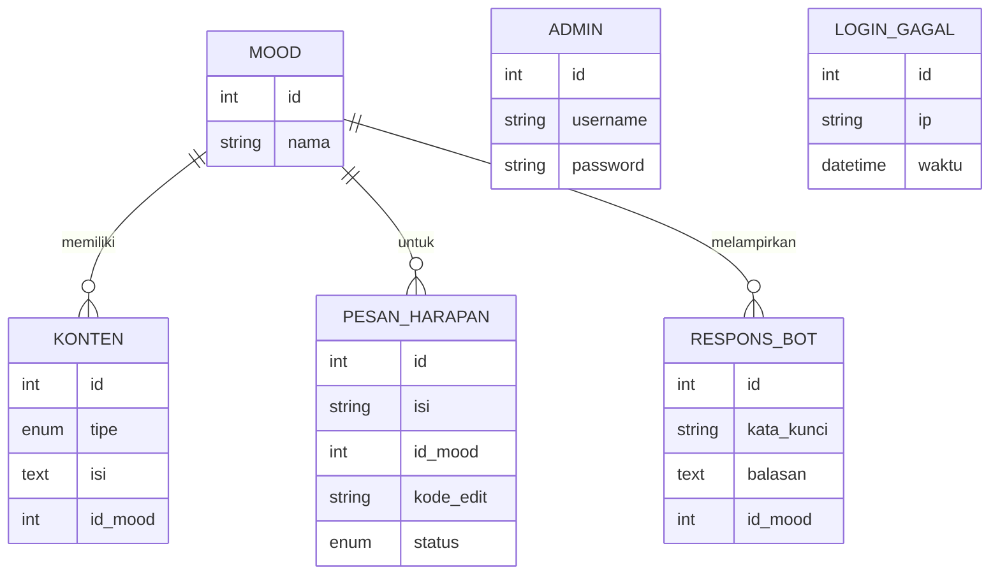

# Release.It

Project Akhir Pemrograman Web. Release.It adalah ruang curhat daring untuk mahasiswa: pengguna menuliskan perasaannya, berbicara dengan chatbot **Rilis**, melepaskan tulisan yang membebani, berlatih napas, dan saling mengirim pesan semangat.

> Release.It bukan pengganti psikolog atau psikiater. Jika kamu merasa ingin mengakhiri hidup, hubungi layanan kesehatan jiwa Kemenkes di **119 ext. 8** atau **112** (darurat), atau ceritakan ke orang yang kamu percaya.

## Fitur

- **Chatbot Rilis**: menjawab dengan AI (opsional, lewat API) dan otomatis memakai balasan berbasis kata kunci jika AI tidak aktif atau gagal.
- **Lepaskan tulisan**: teks melayang dan hilang, tidak dikirim dan tidak disimpan.
- **Ruang tenang**: latihan napas 4-7-8 dengan animasi.
- **Dinding harapan**: pesan semangat anonim dengan moderasi admin, kode edit untuk mengubah atau menghapus pesan sendiri, dan pembatas kirim (anti-spam).
- **Halaman admin**: kelola konten (kutipan, video, gambar), respons chatbot, moderasi pesan, dan ganti password.
- **Deteksi kata berisiko**: dijalankan di server sebelum pesan diteruskan ke AI; menampilkan informasi bantuan nyata.

## Teknologi

PHP 8 (native, PDO), MySQL/MariaDB, HTML, CSS, JavaScript. Dijalankan dengan XAMPP atau Laragon. AI opsional: Google Gemini atau Anthropic Claude lewat API.

## Cara menjalankan

1. Salin folder proyek ke `C:\xampp\htdocs\releaseit` (nama folder menentukan alamat URL).
2. Nyalakan **Apache** dan **MySQL** di XAMPP.
3. Buka `http://localhost/phpmyadmin`, hapus database `releaseit` lama jika ada, lalu **Import** `database.sql`.
4. Cek `config/koneksi.php` (bawaan XAMPP: user `root`, password kosong).
5. Buka `http://localhost/releaseit/`.
6. Admin: `http://localhost/releaseit/admin/login.php`. Akun awal `admin` dengan password `password`. **Ganti segera** lewat menu *Ganti password*.

## Mengaktifkan AI (opsional)

1. Buat API key (Google AI Studio untuk Gemini, atau console Anthropic untuk Claude).
2. Salin `config/ai.example.php` menjadi `config/ai.php`, lalu isi `api_key`, `provider`, dan `model`.
3. **Jangan pernah meng-upload `config/ai.php`** (sudah masuk `.gitignore`). Setiap anggota memakai key masing-masing.
4. Tanpa key, Rilis tetap berjalan dengan balasan kata kunci.

Catatan privasi: saat AI aktif, pesan pengguna dikirim ke penyedia layanan AI. Halaman chat menampilkan pemberitahuan ini.

Jika muncul error SSL di XAMPP, atur `curl.cainfo` di `php.ini` ke file `cacert.pem`, lalu restart Apache.

## Struktur folder

```
releaseit/
├── index.php          halaman chat
├── chat.php           endpoint chatbot (JSON)
├── napas.php          latihan napas
├── dinding.php        dinding harapan (Create, Read)
├── pesanku.php        ubah/hapus pesan via kode (Update, Delete)
├── admin/             login, konten, respons bot, moderasi, ganti password
├── config/            koneksi.php, ai.example.php
├── includes/          header, footer, auth
├── assets/            style.css, app.js, img/
└── database.sql
```

## Database



## Peta CRUD

| Modul | Create | Read | Update | Delete |
|---|---|---|---|---|
| Dinding harapan | `dinding.php` | `dinding.php` | `pesanku.php` | `pesanku.php` |
| Konten | `admin/konten_form.php` | `admin/index.php` | `admin/konten_form.php` | `admin/index.php` |
| Respons bot | `admin/bot_form.php` | `admin/bot.php` | `admin/bot_form.php` | `admin/bot.php` |
| Moderasi pesan | - | `admin/pesan.php` | setujui pesan | hapus pesan |
| Password admin | - | - | `admin/password.php` | - |

## Keamanan dan etika

- PDO prepared statements, output di-escape, token CSRF pada semua form.
- Password admin di-hash (`password_hash`), login dibatasi 5 percobaan gagal per 15 menit per IP.
- Pesan dinding harapan harus disetujui admin sebelum tampil; ada pembatas kirim dan kolom jebakan anti-bot.
- Obrolan tidak disimpan di server. API key hanya dipakai di server.
- Deteksi kata berisiko ada di kode, bukan di database, sehingga tidak bisa terhapus lewat admin.

## Anggota kelompok

- Fahim Shadan Alcyzaq (25076039)
- Farish Perliawan Hendry (25076040)

## Pembagian tugas

- **Faris**: tampilan, `assets/style.css`, `assets/app.js`, `index.php`, `napas.php`.
- **Fahim**: `database.sql`, `config/`, `chat.php`, `dinding.php`, `pesanku.php`, `admin/`.
